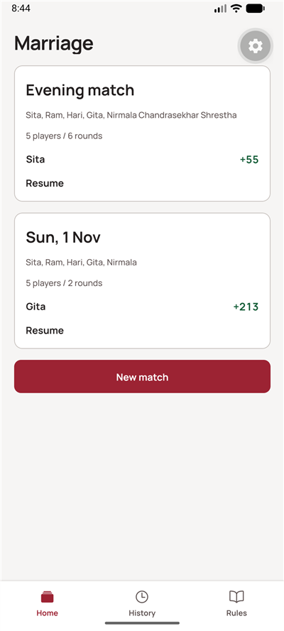
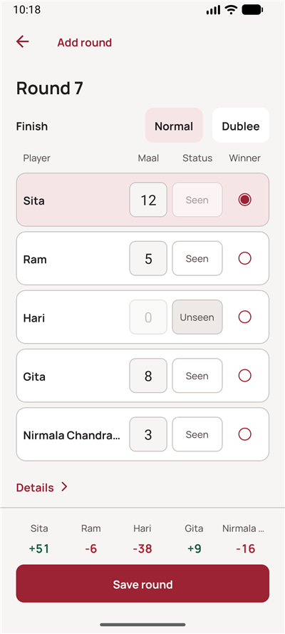
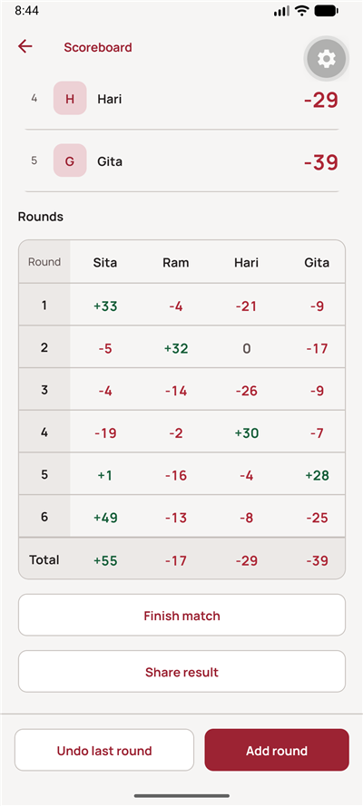

# Marriage Scorekeeper

An offline Android and iPhone scorekeeper for the Nepali card game Marriage. Create a match, enter each round's maal, Seen status and winner, and review standings recomputed from saved inputs. Matches stay on the device with no account or backend.

## Screenshots

Android emulator captures; documentation images are included with source.

| Home                          | Round entry                                       | Standings                                           |
| ----------------------------- | ------------------------------------------------- | --------------------------------------------------- |
|  |  |  |

## Features

- Two to five players, ordered seating and date-based match titles.
- Direct numeric round entry, live points, optional calculation details, editing and undo.
- Per-match finish fees and working normal and Dublee finishes.
- Optional Rs per point, settlement transfers and plain-text result sharing.
- Local SQLite storage, history, finish/reopen controls and automatic dark mode.

## Scoring

Only Seen players' maal counts. For each opponent, multiply their counted maal by the number of players, subtract the total Seen maal, then subtract the finish fee. Default fees are 3 for Seen and 10 for Unseen players. A Dublee finish adds 5 per opponent. The winner must be Seen and receives the opposite of the opponents' combined points, so every round totals zero. Fees are editable when creating a match and apply only to that match.

For example, Sita wins with 5 maal (Seen), Ram has 2 maal (Seen), and Hari is Unseen. Total Seen maal is 7. Ram scores `3 x 2 - 7 - 3 = -4`; Hari scores `0 - 7 - 10 = -17`; Sita scores `+21`. With a Dublee finish, the scores are Ram `-9`, Hari `-22`, Sita `+31`.

The app uses entered maal totals; it does not inspect cards or determine meld eligibility. A winner can have a negative net score. With a money rate, amounts use exact paisa; settlement greedily matches the largest remaining debtor and creditor.

## Tech stack

Expo SDK 58, Expo Router, React Native 0.88, React 19.3, strict TypeScript, expo-sqlite, and locally bundled Manrope fonts.

## Setup

Use Node **22.22.0** and npm. Android development needs the Android SDK and a compatible JDK; iPhone development needs macOS and Xcode.

```sh
npm ci
npm start
npm run android
```

Use a development client. Rebuild it after changing native dependencies or app identifiers. `npm run ios` builds locally on macOS. An installed standalone build works offline; a development client needs Metro.

## Testing

```sh
npm run check
npx expo install --check
npm run bundle:check
```

Checks cover formatting, lint, strict types, scoring, settings, SQLite migrations and transactional persistence, standings, settlement, sharing text and theme contrast. Bundle exports check Android and iOS JavaScript, not native device behavior. See [development notes](docs/DEVELOPMENT.md) for storage and visual verification.

## Sharing source

```sh
git archive --format=zip -o marriage-scorekeeper.zip HEAD
```

This exports the committed revision. Generated native folders, dependencies, Expo caches, bundle output, temporary captures and logs are excluded. Keep screenshots local; capture instructions are in the development notes.

## License

No license has been selected. All rights are reserved until the owner adds one.
