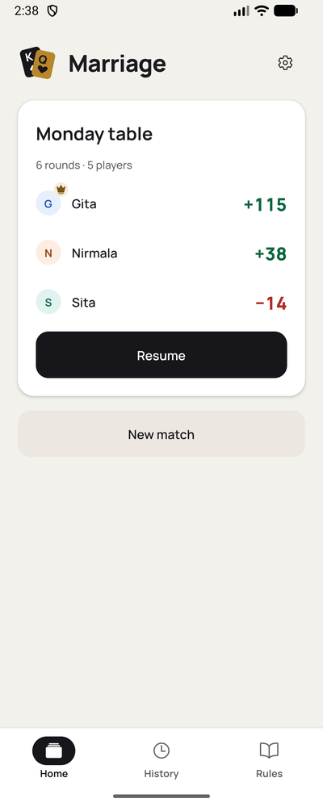
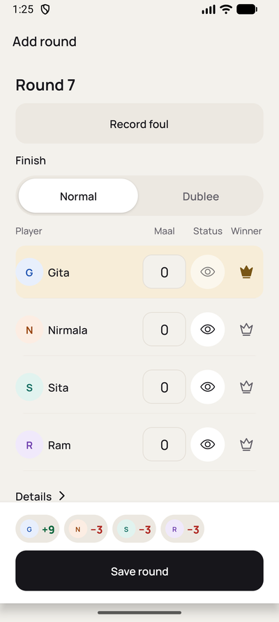
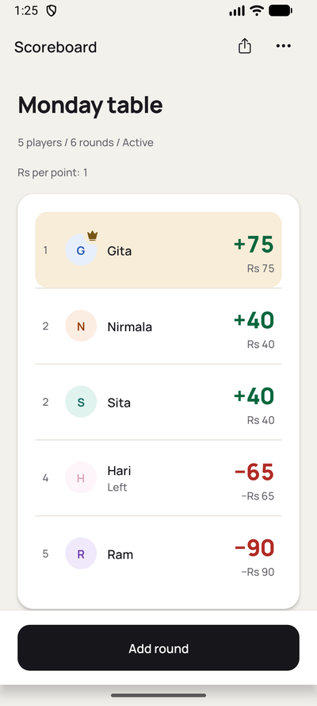
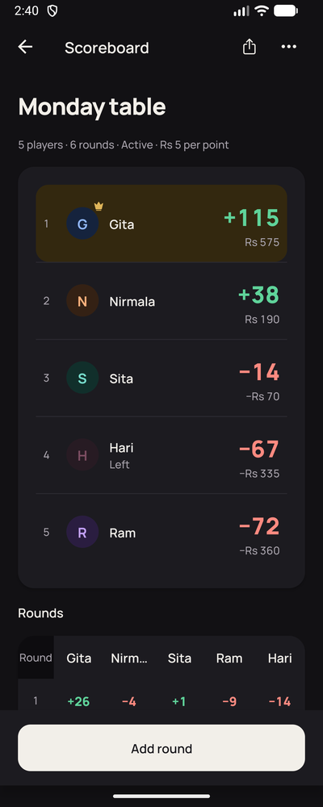
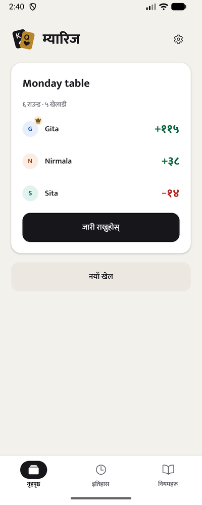

# Marriage Scorekeeper

An offline Android and iPhone scorekeeper for the Nepali card game Marriage, made to keep round scores and settlements in one place.

[Placeholder: rewrite why I built this in my own words.]

Built with AI coding assistants; game rules, design decisions, testing and review by the author.

## Screenshots

| Home                          | Round entry                                 | Scoreboard                                | Scoreboard (dark)                                   | Home (Nepali)                           |
| ----------------------------- | ------------------------------------------- | ----------------------------------------- | --------------------------------------------------- | --------------------------------------- |
|  |  |  |  |  |

## What it does

Track two to five players, normal/Dublee finishes, fouls, changing rosters and rupee settlements. Edit rounds and share results. SQLite keeps matches offline. Supports English/Nepali, Devanagari digits, BS dates and dark mode.

See [scoring rules and examples](docs/SCORING.md) and [translation notes](docs/TRANSLATIONS.md).

## Known limitations

- Single device.
- No backup yet.
- The BS calendar table needs yearly updates.
- Rules are configurable but table-specific.

## Development

Use Node **>=22.22 <23** and npm. Android needs the Android SDK and a compatible JDK; local iPhone builds need macOS and Xcode.

```sh
npm ci
npm run android
# Later sessions with the installed development client:
npm start
```

Use `npm run ios` on macOS. Rebuild the client after native changes; it needs Metro.

`npm run check` runs formatting, lint, types and tests. Also available: `format`, `lint:fix`, `test:coverage` (90% domain/calendar coverage), `bundle:check` (Android/iOS exports), and `npx expo install --check`. Native behavior needs device testing.

Routes: `src/app`; game rules/data/views: `src/features/marriage`; shared UI/theme/translations/storage/helpers: `src/{ui,theme,i18n,storage,lib}`; tests: `tests/{unit,integration,support}`. `@/` means `src/`. Totals derive from saved inputs; migrations must preserve historical data.

The offline BS table (`src/i18n/calendar/bikramSambat.ts`) uses [amitgaru/nepali-datetime's published month lengths](https://github.com/amitgaru/nepali-datetime/blob/master/nepali_datetime/data/calendar_bs.csv) (BS 2000?2100; anchor 2000-01-01 = AD 1943-04-14). Hamro Patro cross-checks exist; full official verification for 2075?2085 remains incomplete. Review future month lengths yearly; unsupported dates use AD.

## License

MIT ? see [LICENSE](LICENSE).
