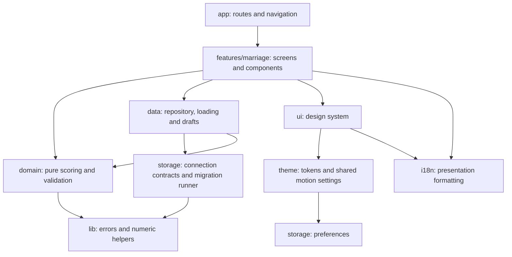
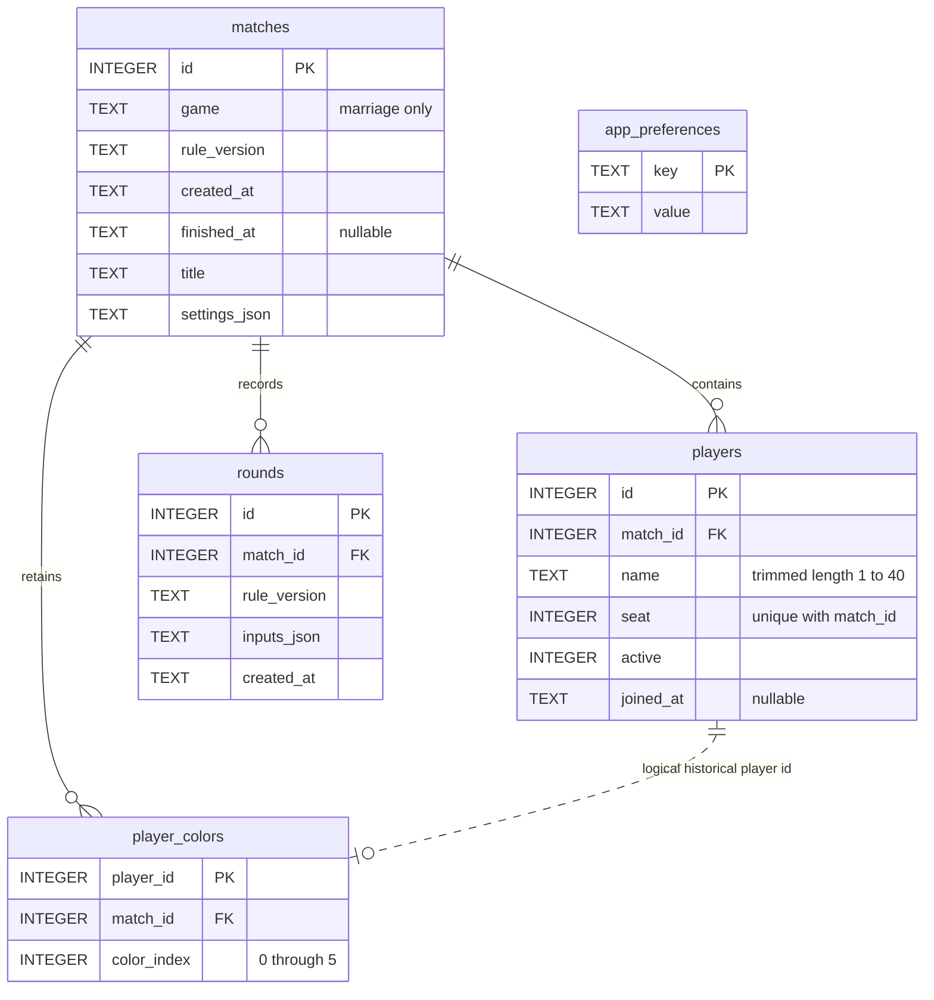

# Architecture

## Layers and dependency rules

Routes in `src/app` only export screens or configure navigation/providers. Route screens live in `features/marriage/screens`; reusable game views live in `components`.



- Domain modules import only other domain modules and pure `lib` utilities. ESLint rejects React, React Native, Expo, storage, i18n, UI, screens, components and data imports there.
- The design system imports no feature modules. ESLint enforces this direction. Game-specific views belong in the Marriage feature.
- Repository functions receive a database connection; domain rules never open SQLite. `MatchStorageProvider` owns the Expo SQLite connection and initialization UI.
- `features/marriage/index.ts` exposes route screens, the draft provider and saved-model types explicitly. Internal code uses specific modules to avoid barrel cycles.
- `@/` resolves to `src/` in TypeScript, Metro and Jest. Imports crossing top-level source folders use the alias; local imports can remain relative.
- Locale-aware match titles and preview errors are presentation adapters in `components`. The domain receives a formatter or returns a structured error. Existing English/Nepali text and formatting are preserved.
- `i18n/matchText.ts` formats the pure domain's standings model for display/sharing; it does not perform database writes. The historical-title migration uses immutable locale/calendar data through `storage/autoTitles.ts`.

## Project layout

```text
src/
  app/                          route exports and navigation layouts
  features/marriage/
    domain/                     pure rules, totals, models and validation
    data/                       SQLite repository, loading hook, draft provider
    components/                 game-specific views and presentation adapters
    screens/                    screen composition and interaction handlers
    index.ts                    explicit public exports
  ui/                           generic design-system components
  theme/                        tokens, useTheme, MotionProvider, motion hooks
  i18n/
    locales/                    en.ts and ne.ts
    calendar/                   offline Bikram Sambat conversion
    index.ts, numbers.ts, dates.ts, matchText.ts
  storage/
    migrations/                 versions 001 through 007
    database.ts                 contracts and exclusive-transaction runner
    preferences.ts, providers, contexts, autoTitles.ts
  lib/                          pure errors/numbers/colors and optional haptics
assets/
  brand/                        outlined KQ SVG
  icons/                        iOS and adaptive Android PNGs
tests/
  unit/                         domain, calendar/i18n, theme, layout, components
  integration/                  SQLite repository, migrations and regressions
```

## Saving a round

1. `RoundEditor` manages the same draft inputs and participant selection as before.
2. The presentation preview adapter invokes pure `domain/roundPreview`; digit normalization, validation and scoring produce canonical inputs and points. Failures are translated at the presentation boundary.
3. Save calls `data/matches.saveRound` with the connection from `MatchStorageProvider`, match ID, canonical input and optional existing round ID.
4. The repository opens an exclusive transaction, reloads the active match, checks ownership and editing rules, validates the canonical input and recomputes safe totals.
5. The transaction inserts or updates `rounds.inputs_json`. It preserves the existing settings, rule version and original edit participants. A failed write rolls back.
6. After success, the editor clears the draft and navigates back with the saved-round notice parameters. `useMatches` reloads persisted inputs; pure totals/standings derive the displayed results. Haptic and animation behavior are unchanged.

## SQLite schema

The restructure retains schema **version 7** and the same SQL constraints, data, table names and indexes. `player_colors` already existed before this restructure and is included below for completeness. Its `player_id` intentionally has no player foreign key: color history survives deletion of an unplayed player.



Foreign keys cascade on match deletion. `players_by_match(match_id, seat)` and `rounds_by_match(match_id, id)` remain unchanged. Totals and standings are derived, not stored. Preferences are device-wide and have no match relationship.

## Migration history

Every migration exports `version` and `up(db)`. The runner reads `PRAGMA user_version`, rejects newer schemas, applies pending versions in order and sets the version after each successful migration, all inside the existing exclusive transaction. It retains foreign keys, WAL and the busy timeout. Failure rolls back the entire pending upgrade.

| Version | Module                  | Existing behavior preserved                                                  |
| ------- | ----------------------- | ---------------------------------------------------------------------------- |
| 1       | `001_initial.ts`        | Matches, players, rounds and lookup indexes                                  |
| 2       | `002_match_titles.ts`   | Match title column                                                           |
| 3       | `003_match_settings.ts` | Settings JSON and legacy rule-ID mapping, without rewriting canonical inputs |
| 4       | `004_player_roster.ts`  | Active status and join timestamps                                            |
| 5       | `005_preferences.ts`    | Device preference key/value table                                            |
| 6       | `006_auto_titles.ts`    | Clear only exact historical auto-generated titles                            |
| 7       | `007_player_colors.ts`  | Backfill persisted palette assignments in joining order                      |

Integration tests exercise upgrades, repeatability, version rejection, rollback and preservation of historical JSON using real Node SQLite. Native bridge behavior is additionally checked in the Android emulator.
